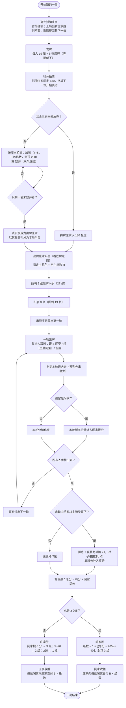
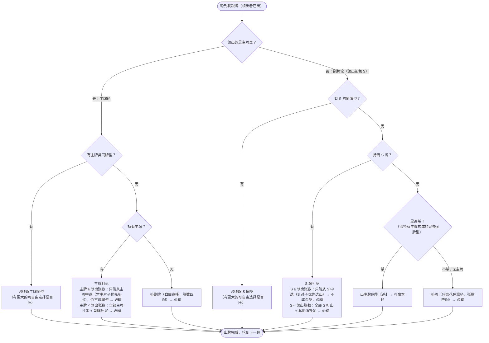
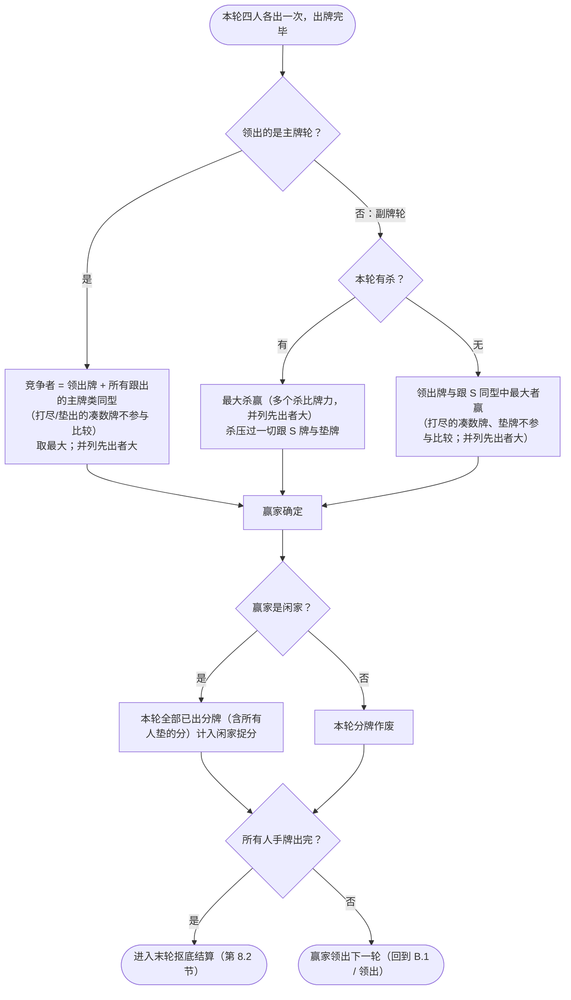

# 三打哈（三打一）规则

> 本文件是三打哈（三打一）的完整规则定义，作为游戏开发与 AI 分析的唯一规则依据。规则按公理陈述，无待确认项。面向无上下文读者：先读第 1、2 节建立全局图景，再进入细则；所有术语在 1.1 术语表定义，各节标注了相互引用。
>
> 工程实现相关的技术决策与开发计划（Godot 框架、里程碑、待定事项）**不在本文件范围内**，另见《三打哈-Godot工程计划.md》。

## 1. 基本设定与术语

| 项目 | 设定 |
|---|---|
| 人数 | 4 人 |
| 用牌 | 两副扑克剔除所有 3、4、6 → **84 张**（点数 5,7,8,9,10,J,Q,K,A,2 各 8 张 + 大王 ×2、小王 ×2） |
| 发牌 | 留 **8 张底牌**（牌面朝下），其余 76 张均分 → **每人 19 张** |
| 座位顺序 | 4 名玩家的固定循环次序（如 甲→乙→丙→丁→甲）；**下一位**即此顺序中的下一名。发牌、叫分表态、轮内出牌均沿此顺序进行 |
| 阵营 | 1 名出牌庄家（独打） vs 3 名闲家（联盟） |
| 胜负 | 叫分 + 闲家捉分 是否 ≥ **205**，按 1/2/3 级结算（第 9、10 节） |

### 1.1 术语表

| 术语 | 含义 | 详见 |
|---|---|---|
| 抓牌庄家 | 每局发牌起点、默认底叫 130 的持有者 | 第 4 节 |
| 出牌庄家 | 叫分拍卖的胜出者，本局独打一方 | 第 4 节 |
| 闲家 | 出牌庄家之外的 3 名玩家，结成联盟 | — |
| 叫分 | 拍卖中报出的分数，兼为本局目标分与结算参数 | 第 5 节 |
| 底牌 / 翻底 / 扣底 | 发牌后留下的 8 张暗牌；翻底 = 庄家将其翻明入手；扣底 = 庄家再任选 8 张扣回 | 第 2 节 |
| 叫主 | 出牌庄家指定主花色与常主点数 R | 第 3.2 节 |
| 常主 | 大王、小王、所有 2，以及叫主指定点数 R 的所有牌；升为常主后脱离原花色 | 第 3.2、3.3 节 |
| 主花色 / 副花色 | 叫主指定的花色为主花色；其余三个花色为副花色，彼此平等 | 第 3.2 节 |
| 正R / 副R / 正2 / 副2 | 主花色的 R 称正R，其余花色的 R 称副R；主花色的 2 称正2，其余花色的 2 称副2（王无花色之分） | 第 3.2 节 |
| 主牌类 / 副牌类 | 主牌类 = 主花色牌 + 全部常主；副牌类 = 副花色中的非常主普通牌。两类不得混构牌型 | 第 3.3 节 |
| 分牌 / 捉分 | 5、10、K 为分牌（5=5 分、10=10 分、K=10 分）；闲家赢轮获得的分牌分值合计称捉分 | 第 8.1 节 |
| 领出 / 领出者 | 一轮中第一个出牌称领出；首轮由出牌庄家领出，之后由上一轮最大者领出 | 第 7.1 节 |
| 无主公示 / 甩打 | 主牌轮垫牌者的【无主】公示；三家均无主时领出者可一次甩出多张主牌单牌（等同连续单张） | 第 7.3 节 |
| 一轮 | 领出起、其余三人按座位顺序各跟牌一次、结算一次的出牌单位 | 第 7.1 节 |
| 跟牌 / 垫牌 / 杀 | 打出与领出同牌型同张数的牌为跟牌；跟不上或不跟时打出的凑数牌为垫牌（必输本轮）；用主牌构成的完整同牌型压制副牌领出称杀 | 第 7.2 节 |
| 抠底 | 末轮由闲家以主牌类赢下时，将底牌分按倍数计入捉分。**注意区分："扣底"是庄家开局弃 8 张暗牌，"抠底"是闲家末轮赢取底牌分，二者无关** | 第 8.2 节 |

## 2. 单局流程（总览）

本章为全局流程总览，可对照流程图自上而下理解。各步骤的细节规则：叫分拍卖 → 第 5 节；叫主与主牌体系 → 第 3 节；牌型 → 第 6 节；出牌与跟牌 → 第 7 节；抓分与抠底 → 第 8 节；胜负分级与收益 → 第 9、10 节；单轮内部的出牌决策与结算 → 附录 B。

```
发牌（每人 19 张 + 8 张底牌牌面朝下）→ 叫分拍卖 → 出牌庄家叫主（看底牌之前）
→ 翻明 8 张底牌入手（27 张）→ 扣底 8 张（回到 19 张）
→ 出牌庄家首出 → 逐轮出牌 → 末轮抠底结算 → 胜负分级 → 结算收益（B×级数）
```

- **底牌保密规则**：叫分拍卖结束前，所有玩家（含抓牌庄家）都不能看底牌；拍卖结束后仅出牌庄家可见（翻底入手），其余三家全程不可见；扣底 8 张任选



主干线一览：**抓牌庄家 → 发牌 → 叫分拍卖 → 叫主 → 翻底/扣底 → 出牌循环（捉分）→ 末轮抠底 → 判定胜负分级 → 收益结算**

## 3. 牌值与主牌体系

### 3.1 单张牌力全序（叫主后）

> 术语 正R、副R、正2、副2、主花色、常主 由 3.2 的叫主产生；叫主前不存在主副之分（叫主前也没有出牌行为），本序仅在叫主后的出牌中使用。

```
大王 > 小王 > 正R > 副R > 正2 > 副2 >
主花色 A > K > Q > J > 10 > 9 > 8 > 7 > 5 >
副牌 A > K > Q > J > 10 > 9 > 8 > 7 > 5
```

- A 为本花色中除 2 外最大的牌；副R > 正2；三个副花色完全平等
- **每轮中领出花色"最大"的含义**：同一轮内，领出花色的牌可胜过其他**副花色**的牌，但输给一切主牌类牌（具体跟牌判定见 7.2）；此规则仅限本轮
- **并列规则**：牌力完全相同（如同花同点的两副牌同张、对杀间的同点副R/副2）→ **先出者大**

### 3.2 叫主

- **强制**叫主，不可宣布无主；点数 ∈ {5,7,8,9,10,J,Q,K,A,2}（含 2 本身），**可任选**（含手里没有的点数）
- **时机：看底牌之前**——出牌庄家（见第 4 节）基于自己 19 张手牌决定，存在赌底牌成分
- 叫主产生以下状态（本局剩余时间有效）：
  - 被指定的花色称**主花色**，其牌力大于一切副花色牌；其余三个花色称**副花色**，彼此平等
  - 被指定的点数 R 升为**常主**：**常主 = 大王、小王、所有的 2、以及点数 R 的所有牌**
  - 主花色的 R 称**正R**，其余花色的 R 称**副R**；主花色的 2 称**正2**，其余花色的 2 称**副2**（王无花色之分）
  - 常主脱离原花色（对跟花色判定与拖拉机构成的影响见 3.3）；正R 可与主花色相邻牌构拖拉机，R 不与副牌构拖拉机（见 6.2）
- R=2 时无独立 R 档（2 本就是常主），全序为 `大王 > 小王 > 正2 > 副2 > 主A > …`

### 3.3 常主牌与原花色的关系

常主牌（王、2、正R、副R）升为常主后**脱离原花色**：

- **跟花色判定**：领出副花色 ♣ 时，手里的 ♣2、♣副R（如 ♣9 且 R=9）**不算 ♣ 牌**——跟花色只看该花色的非常主普通牌；只有常主时视作无 ♣，可杀可垫（杀、垫定义见 1.1 与 7.2）
- **跨类不能成牌型**：主牌类与副牌类**无法跨类形成牌型**——常主 2 与副牌 A 不能构成拖拉机；♣A♣A♣2♣2（♣ 非主花色）不是合法拖拉机
  - 由此推论："AA22 是拖拉机"仅在 A、2 **同属主牌类**时成立（即该花色为主花色，如 ♠AA♠22 且 ♠ 为主）；副花色中 A 无法参与拖拉机（2 跨类不可用、K~A 禁连）→ **副花色拖拉机只能由 7~K 链构成**

## 4. 座位与庄位体系

- 玩家按**座位顺序**（1.1）循环进行所有轮转动作
- **抓牌庄家**：每局发牌起点 + 默认底叫 130 的持有者。初始随机确定；此后——上一局出牌庄家获胜 → 本局抓牌庄家仍是该玩家；落败 → 本局抓牌庄家为其**下一位**
- **出牌庄家**：由叫分拍卖产生（不一定是抓牌庄家）
- 发牌从抓牌庄家开始；首出从出牌庄家开始

## 5. 叫分拍卖

1. 抓牌庄家初始表态固定 **130**，之后正常参与轮流叫分（可加叫、可放弃）
2. 从抓牌庄家的下一位开始轮流表态：**加叫**（新叫分必须高于当前最高叫分，且为 5 的倍数——即加叫幅度至少 +5 且为 5 的倍数；可直接跳至**封顶 200**）或 **放弃**（永久退出本局拍卖，之后不能再叫）
3. 已加叫过的玩家之后也可放弃；当前叫分为 200 时，其余玩家只能放弃
4. 只剩一名未放弃的玩家时拍卖结束：该玩家为出牌庄家，以其最高叫分为本局叫分
5. 其余三家全部放弃 → 抓牌庄家必须以 **130** 坐庄

## 6. 牌型（仅三种：单牌 / 对子 / 拖拉机）

### 6.1 定义

- 单牌：任意 1 张
- 对子：**同花色同点数 2 张**（两副牌同花同点恰好 2 张）
- 拖拉机：**同花色的两组相邻对子**（4 张，如 ♥77♥88；"相邻"见 6.2）

不存在其他牌型（无顺子、三张、三带、飞机、炸弹）。

### 6.2 邻接链

花色内降序：`2 > A > K > Q > J > 10 > 9 > 8 > 7 > 5`；拖拉机还须**同类**（见 3.3：主副牌不跨类）

| 花色 | 可用相邻关系 |
|---|---|
| **主花色**（R 保留在链中） | **两段独立链：`A~2` 与 `K~Q~J~10~9~8~7`**（R 在原位不断链，如 R=9 时 10~9~8 连续）；`A~2` 是独立一段、不含 K（K~A 禁连），两段之间互不相连 |
| **副花色**（R 移除、2 为常主跨类不可用） | **仅 `K~Q~J~10~9~8~7` 一段链**，在 R 处断开（如 R=9：分为 `K~Q~J~10` 与 `8~7` 两段）；A 与 5 不参与拖拉机。**规则修订（2026-11-16）：R=A 时 A 为常主，同花色的 A 对与 2 对相邻（A~2 连，如 ♣AA♣22 且喊 ♠A 为合法拖拉机）；K~A 仍禁连** |
| 禁连 | **K~A**（"首尾禁连"，KKAA 不是拖拉机） |
| 孤点 | **5**（两侧 4、6 已剔除） |

- 副花色中 A 不参与拖拉机（2 跨类不可用、K~A 禁连）；"AA22 是拖拉机"在**主花色**成立（如 ♠AA♠22 且 ♠ 为主），且 **R=A 时任意花色的同花色 AA22 亦成立（2026-11-16 修订）**
- **主花色链保留 R**：正R 可与主花色相邻牌组拖拉机（♠为主、R=9 时 ♠1010♠99、♠99♠88 合法）
- **副花色链移除 R**：R=9 时 ♣1010♣88 非法、♣JJ♣1010 合法
- 叫 R=2 时主花色链不变（2 本就在链中）
- **R=5 的链行为**：5 本是孤点，升为常主后仍是孤点——正5对与副5对都无法参与任何拖拉机（主副花色皆然）；其余点数的链不受影响

### 6.3 拖拉机与常主组合

- **四个王 = 最大的拖拉机**（对大王 + 对小王；王无花色，唯一不受同花色约束的特例）
- **不同花色的常主对子组合不是拖拉机**（正R对+副R对、正2对+副2对、小王对+正R对等）——拖拉机必须同花色（6.1）且满足 6.2 邻接，四王是唯一例外。这类组合只能当作**两个独立对子**打出，不构成拖拉机牌型
- 拖拉机比较：**主牌类拖拉机 > 一切副牌拖拉机**；同类比"较大一组"在 3.1 全序中的位置。**规则修订（2026-11-16）：AA22（A 对 + 2 对）在其花色的同类拖拉机中排最小——主牌 AA22 < 主牌 7788 < 更大的同类拖；跨花色比较不变（主牌类 > 副牌类，杀必赢）。特别地，R=A 时副花色 AA22（如 ♣AA♣22 且喊 ♠A）属主牌类，仍大于一切副牌拖拉机（含同花色的 ♣KK♣QQ 等副牌拖）——"副2/副R"的"副"只相对主花色而言，不改变其主牌类身份**

## 7. 出牌规则

### 7.1 基本框架

1. 每轮每人出**相同张数**（1/2/4，由领出牌型决定）；首轮由出牌庄家领出，之后每轮由上一轮最大者领出，牌型任选
2. **轮内次序**：领出者出牌后，其余三人按座位顺序依次跟牌，每人每轮只出一次；四人出完即结算本轮
3. 领出者每轮只领一个完整牌型，剩余牌自然逐轮拆分出完（剩 3 张 = 对+单 两轮，或 单+单+单 三轮）
4. 因每轮每人等量出牌，所有人**同时出完**，游戏结束

### 7.2 跟牌规则

**领出副牌花色 S 时**：

1. 有 S 的同牌型 → **必须**跟该牌型（有更大的不强制压，但必须出 S 的该牌型）。**选牌自由**：满足牌型的前提下，具体出哪些牌完全自由——如同点的两张（两副牌同张）任选一张、手中有多组同型（如两个 ♣ 对子）任选一组；合法性只校验牌型与张数
2. 有 S 牌但凑不齐牌型 → **必须优先打 S 牌**：S 牌多于领出张数时只能从 S 牌中选，**且 S 对子优先选出**（如领 ♣ 拖拉机、持有 ♣55♣66♣K 时应出 ♣55♣66；多组对子任选，见选牌自由）；不足领出张数时全部打出并从其他花色或主牌补足；此时整手牌不成杀型，**必输本轮**
3. 无 S 牌 → 可出**主牌构成的完整同牌型 =【杀】**赢本轮（无合适主牌则只能垫）；或直接垫牌必输

**领出主牌时**：

- 有主牌类同牌型 → **必须**跟（有更大的不强制压；选牌自由同上——多组同型任选其一）
- 无主牌类同牌型但持有主牌 → **主牌打尽**（类比副牌轮的 S 打尽）：领出张数内必须全部打主牌——主牌不足领出张数时全部打出并从副牌补足（此时必输本轮）；主牌多于领出张数时只能从主牌中挑选，且**常主对子（大小王对、正2/副2 对、正R/副R 对）必须优先打出；主花色普通对（如 ♠ 为主时的 ♠55）不强制优先**（见垫牌规则）
- 无任何主牌 → 垫副牌，无法竞争本轮。**领出为常主对子（王对 / 2 对 / 正R/副R 对，非主花色）时同样成立**：垫牌完全自由——不强制垫该对子原花色的对子或散张（垫其原花色散张、垫其他花色对子、垫不成对散张均合法）；「常主对子必须优先垫出」的强制项仅约束**持有主牌且主牌多于领出张数**的挑选场合，与无主牌的自由垫牌无关。例：♠ 主、R=9，庄家领 ♥99（♥9 为副R常主对），闲家无任何主牌 → 垫 ♥8♥7（原花色散张）、垫 ♣77、垫 ♥8+♦Q 均合法

**杀与散主牌**：

- 杀 = **主牌（含常主、副R）构成的完整同牌型**，用于压制副牌领出
- 出主牌但**非同牌型**（如领对子时出"大王+小王"散牌、领拖拉机时出不成拖拉机的主牌组合）→ 牌力更低，作垫必输
- 多个杀之间按牌力比较大小；并列 → 先出者大

**垫牌**：

- 可混任意花色、跨主副（不限制）；垫牌张数 = 领出张数；垫牌必输本轮
- 总优先级：**主副 > 花色 > 牌型**，强制项仅一处：
  - 【强制】领出**主牌轮**：手中主牌牌**打尽**（见"领出主牌时"）；主牌多于领出张数、需在主牌内挑选时，**常主对子（大小王对、2 对、正R/副R 对）必须优先垫出**（如主牌拖拉机 7788 时，大小王对子/2 对子必须优先垫出）；主花色普通对不强制
  - 领出**副牌轮**：领出花色 S 的牌必须打尽——S 牌中的对子（如 ♣ 对）随"打尽"一并打出；S 牌多于领出张数需挑选时，**S 对子优先选出**（领出为 S 对子/拖拉机时皆然）；**无 S 牌时垫牌完全自由，垫其他花色不强求出对子**（垫两对或垫散张均合法）
  - 【建议】对子优先于散张——非强制规则，作为线上出牌提示与 AI 垫牌策略

**下分不强制**：无强制出分牌规则；但领出花色的分牌按跟牌规则可能被迫打出

**四王的强制与保留**：

- 领出**主牌拖拉机**、且你唯一的主牌拖拉机就是四王（两对王）→ **必须打出**，成为最强牌力
- 领出**副牌**时，四王作为杀是**可选**的（可保留待后期使用）
- 手中有多副主牌拖拉机（含四王）时，跟主牌拖拉机轮可自由选择

### 7.3 无主公示与主牌甩打（2026-11-17 增补）

**无主公示**：

- 主牌轮中某玩家**未能打出任何主牌**（垫牌）时，在其姓名牌右下角加盖【无主】红印章公示
- 依据：7.2 强制项的逆否——领出主牌时有主牌必须打尽，未出主牌即证明手中已无任何主牌类牌
- 公示本局内持续有效（主牌只减不增）；**副牌轮垫牌不触发公示**；主牌打尽（出了主牌但恰好用完）亦不触发

**主牌甩打**：

- 条件：当前领出者**之外的三家均已无主牌**（以公示或实际持牌为准，引擎按实际手牌判定）
- 满足时，领出者可将**任意张主牌单牌**一次性甩出，效果**等同连续领出多个主牌单张轮**：
  - 其余三家各**垫出与甩打张数相同的牌**（完全自由，均必输，无任何强制项）
  - 每一"张"都视作一个单张轮：领出者赢下全部，本轮所有分牌按赢家阵营计捉分 / 作废
  - 甩打后的下一轮仍由领出者领出（赢家连续）
- 甩打组合**不构成对子 / 拖拉机**：成型主牌牌型按普通领出处理（三家无主时主牌牌型同样必赢，效果等价）
- **末轮甩打**赢局属闲家时动抠底：按**单张 ×1** 计（与"连续单张"口径一致，8.2）

## 8. 抓分与抠底

### 8.1 抓分

- 分牌：5 = 5 分，10 = 10 分，K = 10 分，两副牌共 **200 分**（王、7、8、9、J、Q、A、2 无分）
- **分牌身份与分值不随常主化改变**：如 R=5 时正5/副5 仍是 5 分牌，R=K 时正K/副K 仍是 10 分牌；全局总分恒为 200 分
- **只有闲家能捉分**：闲家赢轮 → 本轮所有已出分牌（含他人垫出的分）计入闲家捉分；庄家赢轮 → 该轮分牌作废
- 闲家捉分上限：未抠底时为 **200 − 底牌分**；末轮以对子/拖拉机抠底（×2）时可达 **200 + 底牌分**
- 垫分策略合法：庄家可垫分给闲家以保留大牌型；闲家可在牌力不济时垫分喂队友

### 8.2 末轮抠底

- **条件**：最后一轮（游戏最后一轮，四人参与）由**闲家**赢下，且赢牌为**主牌类**（主花色、常主：王/2/正R/副R）
- **倍数**：赢牌为单牌 → 底 8 张中的分牌 **×1** 计入捉分；赢牌为对子或拖拉机 → **×2** 计入捉分
- 闲家用副牌赢末轮、或庄家赢末轮 → 底牌分作废
- 策略注记：庄家主牌通常更多，被抠底较罕见；**把副牌分放进底牌**是常规优策，AI 扣底以此为默认策略即可

## 9. 胜负与级

- 判定指标：**总分 = 叫分 + 闲家捉分（含抠底）**
- **闲家胜**：总分 ≥ **205**；级数 = 1 + ⌊(总分−205)/40⌋，封顶 3 级（205~244 → 1 级；245~284 → 2 级；≥285 → 3 级）
- **庄家胜**：总分 < 205；闲家捉 0 分 → 庄家赢 3 级；闲家捉 5~20 分 → 庄家赢 2 级；闲家捉 ≥25 分（未达闲家胜线）→ 庄家赢 1 级（捉分恒为 5 的倍数，21~24 档不存在）

## 10. 收益结算

- 约定**基底分 B**（房间/玩家约定）
- 庄家赢 → **每位闲家支付 庄家 B×级数**；闲家赢 → **庄家支付 每位闲家 B×级数**
- 叫分不进入收益公式 → 加叫抢庄的收益动机 = 亲自坐庄独赢这份收益

## 附录 A：完整一局推演

> 目的：用一局具体牌例演示全部规则的执行。座位固定顺序 **甲→乙→丙→丁** 循环；基底分 B=1（示例）。
> 未展示的手牌从略，每轮出牌的合法性以该轮描述的手牌前提为准。

### A.1 设定

- 上一局庄家甲获胜 → 本局**抓牌庄家 = 甲**；发牌从甲开始，每人 19 张 + 8 张底牌

### A.2 拍卖与叫主

1. 甲（抓牌庄家）固定叫 **130** → 乙加叫 **140** → 丙**放弃**（永久退出）→ 丁加叫 **160** → 甲放弃 → 乙放弃 → 只剩丁 → **丁以 160 分坐庄**（出牌庄家）
2. 丁**看底牌前**叫主：**♠ 为主花色，R = 9**（♠9 即正9）——含赌底牌成分
3. 翻底 8 张（仅丁可见）：♣10 ♣5 ♥10 ♥5 ♦K ♦5 ♣Q ♥J（含 **35 分**）
4. 丁扣底：将上述 8 张全部扣回（副牌分入底、主牌留手上——常规优策）；这 35 分只能通过**末轮抠底**获得

### A.3 第 1 轮：庄家领出含分拖拉机，被闲家杀

丁领出 ♣J♣J♣10♣10（副花色拖拉机，内含 20 分）：

| 顺序 | 玩家 | 出牌 | 规则依据 |
|---|---|---|---|
| 1 | 丁（领出） | ♣JJ♣1010 | 庄家首出/上轮赢家领出 |
| 2 | 甲 | ♣10♣5 ＋ ♦7♦8 | 有 ♣ 牌但无 ♣ 拖拉机 → ♣ 牌**必须打尽**＋任意凑数；不成杀型 → 必输 |
| 3 | 乙 | ♥88♥99 | 无 ♣ 牌；♥ 非主花色 → 副牌拖拉机**救不了**，只能垫。垫牌完全自由：垫两对是自由选择，垫 4 张散牌同样合法（其他花色对子不强制） |
| 4 | 丙 | ♠88♠99 | 无 ♣ 牌 → 主牌拖拉机**【杀】**（♠主花色链保留 R=9，8~9 相邻） |

- **丙赢轮** → 捉得本轮全部分牌 **35 分**（领出 20＋甲垫 15）→ 归闲家
- 演示点：S 牌打尽义务；跨副花色拖拉机无竞争力；庄家冒险领出含分牌被杀

### A.4 第 2 轮：主牌单张轮

丙领出 **小王**（主牌单张）：

| 顺序 | 玩家 | 出牌 | 规则依据 |
|---|---|---|---|
| 1 | 丙（领出） | 小王 | 上轮赢家领出 |
| 2 | 丁 | ♠10 | 有主牌单张**必须跟**（♠10 属主花色普通牌） |
| 3 | 甲 | **大王** | 跟主牌单张，选择最大的 → 赢 |
| 4 | 乙 | ♥2 | **常主脱离花色**：♥2 是主牌，可跟主牌轮；反之若本轮领的是 ♥ 单张，♥2 不算"有 ♥ 牌" |

- **甲赢轮**（大王 > 小王），本轮无分

### A.5 第 3 轮：副牌对子轮

甲领出 ♣KK（♣ 非主花色，20 分）：

| 顺序 | 玩家 | 出牌 | 规则依据 |
|---|---|---|---|
| 1 | 甲（领出） | ♣KK | 上轮赢家领出 |
| 2 | 乙 | ♣5♣5 | 有 ♣ 对子**必须跟**（不强制压） |
| 3 | 丙 | ♠9♠9 | 无 ♣ 牌 → **正9对【杀】** |
| 4 | 丁 | ♦Q♦J | 无 ♣ 牌；有杀能力但杀**可选** → 垫牌保留主牌实力 |

- **丙赢轮** → 捉得 **30 分**（♣KK 20＋♣55 10）
- 演示点：跟 S 牌型不强制压；杀压过一切跟 S 牌；杀的保留权

### A.6 末轮：抠底 ×2

乙领出 ♦JJ♦1010（副花色拖拉机，内含 20 分）：

| 顺序 | 玩家 | 出牌 | 规则依据 |
|---|---|---|---|
| 1 | 乙（领出） | ♦JJ♦1010 | 上轮赢家领出 |
| 2 | 丙 | ♣K♣A♣Q♣J | 无 ♦ 牌；不能赢 → **垫分喂队友**（♣K=10 分，垫牌自由） |
| 3 | 丁 | ♠7♠5＋♣Q♥A | 无 ♦ 牌；散主牌不成杀型 → 作垫必输 |
| 4 | 甲 | **四王**（大小王各一对） | 无 ♦ 牌；**主牌拖拉机【杀】**——四王在副牌轮是可选杀，甲刻意保留到末轮 |

- **甲赢轮**：轮内分 20＋10 = **30 分**；闲家用**主牌拖拉机**赢末轮 → **抠底 ×2**：35 × 2 = **70 分** → 甲共 +100
- 演示点：四王的可选保留；散主牌作垫必输；末轮抠底倍数；闲家垫分配合

### A.7 结算

- 闲家捉分 = 35（丙，第1轮）＋ 30（丙，第3轮）＋ 100（甲，末轮含抠底）= **165**
- 总分 = 叫分 160 ＋ 165 = **325** ≥ 205 → **闲家胜**
- 级数 = 1 ＋ ⌊(325−205)/40⌋ = 1＋3 = 4 → **封顶 3 级**（恰好演示封顶规则）
- 收益：庄家丁向甲、乙、丙**各支付 B×3**
- 对照示例：若闲家只捉 20 分 → 总分 180 < 205 → **庄家赢 2 级**（闲家捉 5~20 档），甲乙丙各付丁 B×2

### A.8 推演结论

- 全流程（庄位 → 拍卖 → 叫主 → 翻底/扣底 → 跟/杀/垫 → 抓分 → 抠底 → 分级 → 收益）规则闭环，无据可依的局面不存在
- 副花色 A 不参与拖拉机（见 3.3）

## 附录 B：单轮出牌决策流程

> 本附录是第 7.1 / 7.2 节的等价流程化表述，便于核对理解；若与正文冲突，以正文为准。

### B.1 单人跟牌决策树（轮到我跟牌时）



要点对照：跟同型必出（有更大不强制压）→ 7.2 第 1 条；S/主牌打尽 → 7.2 第 2 条与"领出主牌时"；杀的条件 → 7.2"杀与散主牌"；垫牌自由与常主对子强制 → 7.2"垫牌"；三家无主时的多张主牌甩出 → 7.3"主牌甩打"。

### B.2 一轮结算流程（四人出完后）



要点对照：赢家判定与并列规则 → 3.1、7.1；捉分与作废 → 8.1；末轮衔接 → 8.2、第 2 节。
